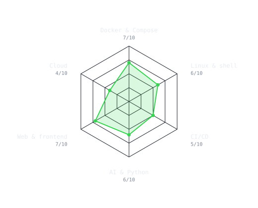
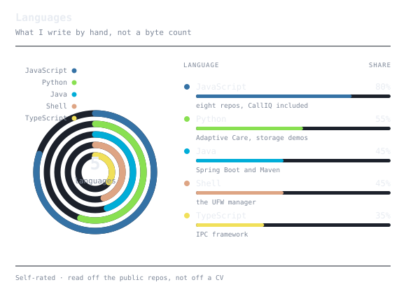
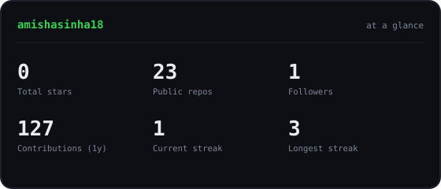
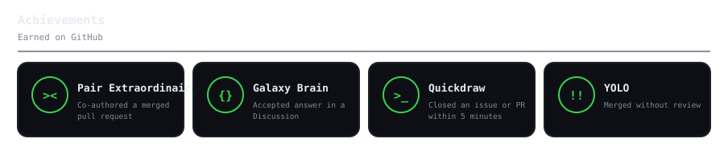
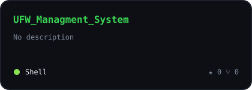
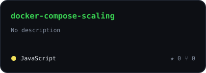
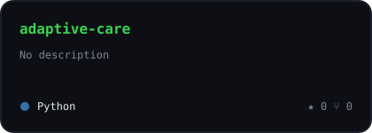
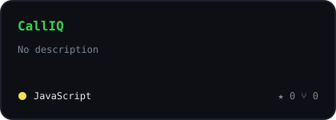

<!--
  github.com/amishasinha18/amishasinha18 — the repo name matches the username, which
  is what makes GitHub render this file at the top of the profile page.

  The radar, gauge, cards and achievement tiles are SVGs committed to assets/, drawn
  by the scripts in scripts/ and refreshed by the workflows in .github/workflows/.
  Nothing here is fetched from a chart service at render time. See SETUP.md.
-->

<div align="center">

<!-- PORTRAIT — scripts/dotify.py. Transparent source, so one file serves both themes,
     and --animate fades the rows in from the top:
     python scripts/dotify.py assets/source.png -o assets/portrait        --cols 150 --color --flat --detail 0.82 --animate -->


<br>

<a href="https://amishasinha.vercel.app/">
  
</a>

<br>

<a href="https://amishasinha.vercel.app/"></a>
<a href="https://www.linkedin.com/in/amishasinha18/"></a>
<a href="mailto:thisisamishasinha@gmail.com"></a>

<br>

<!-- The one third-party service here, and unavoidably so: counting views needs a
     server that sees the requests, which a static README cannot do for itself. -->


</div>

---

## `~/` whoami

```console
$ cat about.txt
```

Cloud computing and AI, learned by building the thing rather than reading about it.
Most of what is here started as "can I actually get this running".

- **Docker and Compose** across six repos — horizontal scaling, persistent storage, dependent startup
- **Linux** — a UFW firewall manager in Bash, with both a CLI and a TUI
- **CI/CD** — a Jenkins pipeline and a Maven build on a containerised Spring Boot app
- **Python and AI** — Adaptive Care, a healthcare chatbot built on Groq
- Building **CallIQ**, a WebRTC contact-centre platform, with [@geekksv](https://github.com/geekksv)
- Learning **AWS, Kubernetes, Terraform and Ansible** — the cloud side of the job
- **B.Tech CSE**, heading for cloud engineering

> The rest of it — projects, writing, contact — is at
> **[amishasinha.vercel.app](https://amishasinha.vercel.app/)**.

<br>

<div align="center">

## `~/` toolbox


</div>

---

<div align="center">

## `~/` how I ship


</div>

---

<div align="center">

## `~/` where the time goes

<table>
<tr>
<td width="50%" align="center" valign="middle">

<!-- Both charts come from assets/skills.json; edit it and the workflow redraws them. -->
<picture>
  <source media="(prefers-color-scheme: dark)"  srcset="assets/radar-dark.svg">
  <source media="(prefers-color-scheme: light)" srcset="assets/radar-light.svg">
  
</picture>

</td>
<td width="50%" align="center" valign="middle">

<picture>
  <source media="(prefers-color-scheme: dark)"  srcset="assets/langs-dark.svg">
  <source media="(prefers-color-scheme: light)" srcset="assets/langs-light.svg">
  
</picture>

</td>
</tr>
</table>

</div>

---

<div align="center">

## `~/` contributions


<br><br>

<picture>
  <source media="(prefers-color-scheme: dark)"  srcset="https://raw.githubusercontent.com/amishasinha18/amishasinha18/output/pacman-contribution-graph-dark.svg">
  <source media="(prefers-color-scheme: light)" srcset="https://raw.githubusercontent.com/amishasinha18/amishasinha18/output/pacman-contribution-graph.svg">
  
</picture>

</div>

---

<div align="center">

## `~/` the numbers

<picture>
  <source media="(prefers-color-scheme: dark)"  srcset="assets/card-stats-dark.svg">
  <source media="(prefers-color-scheme: light)" srcset="assets/card-stats-light.svg">
  
</picture>

<br><br>

<!-- Hand-kept list: GitHub publishes profile achievements in no API, only in the
     HTML of the profile page. See assets/achievements.json. -->
<picture>
  <source media="(prefers-color-scheme: dark)"  srcset="assets/achievements-dark.svg">
  <source media="(prefers-color-scheme: light)" srcset="assets/achievements-light.svg">
  
</picture>

</div>

---

<div align="center">

## `~/` selected work

<table>
<tr>
<td width="50%">
  <a href="https://github.com/amishasinha18/UFW_Managment_System">
    <picture>
      <source media="(prefers-color-scheme: dark)"  srcset="assets/card-UFW_Managment_System-dark.svg">
      <source media="(prefers-color-scheme: light)" srcset="assets/card-UFW_Managment_System-light.svg">
      
    </picture>
  </a>
</td>
<td width="50%">
  <a href="https://github.com/amishasinha18/docker-compose-scaling">
    <picture>
      <source media="(prefers-color-scheme: dark)"  srcset="assets/card-docker-compose-scaling-dark.svg">
      <source media="(prefers-color-scheme: light)" srcset="assets/card-docker-compose-scaling-light.svg">
      
    </picture>
  </a>
</td>
</tr>
<tr>
<td width="50%">
  <a href="https://github.com/amishasinha18/adaptive-care">
    <picture>
      <source media="(prefers-color-scheme: dark)"  srcset="assets/card-adaptive-care-dark.svg">
      <source media="(prefers-color-scheme: light)" srcset="assets/card-adaptive-care-light.svg">
      
    </picture>
  </a>
</td>
<td width="50%">
  <a href="https://github.com/amishasinha18/CallIQ">
    <picture>
      <source media="(prefers-color-scheme: dark)"  srcset="assets/card-CallIQ-dark.svg">
      <source media="(prefers-color-scheme: light)" srcset="assets/card-CallIQ-light.svg">
      
    </picture>
  </a>
</td>
</tr>
</table>

<sub>

| project | what it is | stack |
|---|---|---|
| **[UFW Management System](https://github.com/amishasinha18/UFW_Managment_System)** | An interactive wrapper around Linux UFW, with both a classic CLI and a TUI | `Bash` `Linux` |
| **[docker-compose-scaling](https://github.com/amishasinha18/docker-compose-scaling)** | Scaling backend microservices horizontally on demand under sudden load | `Docker` `Compose` |
| **[adaptive-care](https://github.com/amishasinha18/adaptive-care)** | A healthcare chatbot for symptoms and medication questions, built on Groq | `Python` `Groq` |
| **[CallIQ](https://github.com/amishasinha18/CallIQ)** | A WebRTC contact-centre platform — voice, chat, live supervision | `Next.js` `LiveKit` `Postgres` |

</sub>

<sub><a href="https://amishasinha.vercel.app/">amishasinha.vercel.app</a></sub>

<br><br>

<!-- "keep automating" in binary, deliberately left without a plain-text twin. -->
<sub><code>01101011 01100101 01100101 01110000 00100000 01100001 01110101 01110100 01101111 01101101 01100001 01110100 01101001 01101110 01100111</code></sub>

</div>
