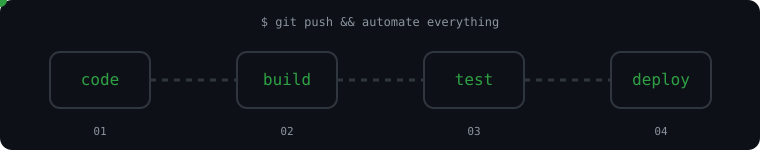

<h1 align="center"><code>Amisha Sinha</code></h1>

<p align="center"><b>Cloud and DevOps Enthusiast</b><br><i>Bridging problems to automated cloud solutions</i></p>

<p align="center">
  <a href="https://amishasinha.vercel.app/"></a>
  <a href="https://www.linkedin.com/in/amishasinha18/"></a>
  <a href="mailto:thisisamishasinha@gmail.com"></a>
</p>

<p align="center">
  
</p>

---

## ~/ whoami

```bash
$ cat about.txt
```

Cloud and DevOps learner. I like turning repetitive work into automation, and bridging problems to automated cloud solutions.

- Hands-on Linux administration: servers and the command line
- Containerizing apps with **Docker** and building **CI/CD** pipelines
- Building and deploying cloud projects on **AWS**
- Replacing repetitive work with scripts and automation
- Learning **Kubernetes** and **Terraform**

---

<h2 align="center">~/ toolbox</h2>

<p align="center">
  
</p>

---

<h2 align="center">~/ how I ship</h2>

<p align="center">
  
</p>

---

<h2 align="center">~/ contributions</h2>

<p align="center">
  
</p>

---

<h2 align="center">~/ the numbers</h2>

<p align="center">
  
</p>
<p align="center">
  
</p>

---

<h2 align="center">~/ selected work</h2>

| project | live | stack |
|---|---|---|
| [**CallIQ**](https://github.com/amishasinha18/CallIQ)<br>Real-time WebRTC contact-center platform: voice, chat, live supervision and analytics | [calliq-web](https://calliq-web-mfv4.onrender.com/) | `Node.js` `Next.js` `WebRTC` `Postgres` `Socket.IO` |
| [**file-compression-utility**](https://github.com/amishasinha18/file-compression-utility)<br>Huffman coding engine written in C++, wrapped in a Flask web app | [file-compression-utility](https://file-compression-utility.onrender.com) | `C++` `Python` `Flask` |
| [**IPC_FRAMEWORK**](https://github.com/amishasinha18/IPC_FRAMEWORK)<br>IPC framework in C (pipes, message queues, shared memory) with token-based security and a Next.js dashboard | n/a | `C` `Next.js` `React` `OpenSSL` |

<p align="center">
  <a href="https://amishasinha.vercel.app/">amishasinha.vercel.app</a> · Patna, Bihar, India
</p>

<p align="center"><code>01101011 01100101 01100101 01110000 00100000 01100001 01110101 01110100 01101111 01101101 01100001 01110100 01101001 01101110 01100111</code></p>
